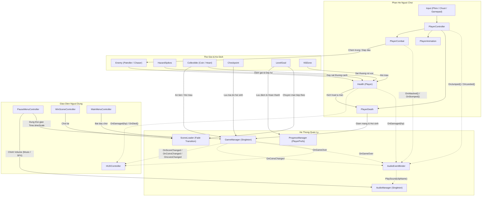

# Báo Cáo Đồ Án: Xây Dựng Game 2D Platformer Trong Unity 6

Dự án game đi cảnh 2D màn hình ngang cổ điển (Pixel Art 2D Platformer) được xây dựng hoàn toàn trên nền tảng **Unity 6000.0.85f1** và ngôn ngữ lập trình **C#**.

Toàn bộ tài nguyên đồ họa (Sprites, Tiles, Animations), âm thanh 8-bit và cấu trúc các màn chơi đều được khởi tạo tự động 100% bằng mã nguồn (Procedural Generation), tuân thủ kiến trúc phân tách độc lập (Decoupled Architecture) và chuẩn API hiện đại nhất của Unity 6.

---

## 1. Tổng Quan Dự Án

- **Thể loại**: 2D Action Platformer / Màn hình ngang (Side-scrolling).
- **Phong cách đồ họa**: Pixel Art procedural (tạo động từ mã C#, không dùng asset ngoài).
- **Hệ thống màn chơi**:
  - `MainMenu`: Màn hình bắt đầu game, hiển thị điểm số kỷ lục (High Score), nút bắt đầu chơi và nút thoát.
  - `Level1`: Màn chơi mở đầu làm quen với cơ chế nhảy, thu thập xu, tiêu diệt quái tuần tra và lưu mốc Checkpoint.
  - `Level2`: Màn chơi tầm trung với nhiều hố gai nhọn, quái truy đuổi (Chaser) và địa hình bậc thang phức tạp.
  - `Level3`: Màn chơi thử thách cao độ kết hợp hố sâu, bẫy chông liên hoàn, mật độ kẻ địch dày đặc và kiểm tra phản xạ nhảy kép.
  - `WinScene`: Màn hình vinh quang sau khi chinh phục cả 3 màn chơi, tổng kết điểm kỷ lục và tùy chọn chơi lại.
  - `TestLevel`: Màn chơi sandbox để kiểm thử độc lập chuyển động vật lý của Player.

---

## 2. Công Nghệ & Môi Trường Sử Dụng (Tech Stack)

| Thành phần | Phiên bản / Công nghệ sử dụng | Ghi chú |
| :--- | :--- | :--- |
| **Game Engine** | Unity 6 (`6000.0.85f1`) | Phiên bản LTS 64-bit cho Windows |
| **Ngôn ngữ** | C# (.NET Standard 2.1 / C# 9.0+) | Hỗ trợ Pattern Matching, Records, Action delegates |
| **Hệ thống vật lý** | 2D Physics (Box2D Engine) | Sử dụng API Unity 6: `Rigidbody2D.linearVelocity`, `CompositeCollider2D.compositeOperation` |
| **Input System** | Unity New Input System + Legacy Fallback | Tương thích đa thiết bị (`Keyboard`, `Mouse`, `Gamepad`) |
| **Render Pipeline** | Universal Render Pipeline (URP 2D) | Pixel Perfect Sprite Rendering, Sorting Layers |
| **Giao diện (UI)** | Unity UI (uGUI) & TextMeshPro | TMP Essential Resources, Canvas Scaler Full HD 1080p |
| **Âm thanh** | Procedural 8-bit Synthesizer | Tạo sóng âm thanh Waveform tự động trong bộ nhớ qua PCM float buffer |

---

## 3. Cấu Trúc Thư Mục Dự Án (Folder Hierarchy)

Dự án tuân thủ nghiêm ngặt quy chuẩn phân cấp thư mục rõ ràng, phân định độc lập giữa mã nguồn Editor và Runtime:

```
Platformer2D/
├── Assets/
│   ├── Art/
│   │   ├── Sprites/         # Các sprite sinh tự động (Player, Quái, Hiệu ứng Slash, Coin, Tim, Gai, Cột cờ)
│   │   └── Tiles/           # Tile Palette assets và Sprite ô đất (Ground Top, Ground Fill, Brick Platform)
│   ├── Audio/               # Nơi lưu trữ tài nguyên âm thanh
│   ├── Editor/              # Toàn bộ mã nguồn tự động hóa và công cụ xây dựng màn chơi
│   │   ├── AnimationAndAudioBuilder.cs  # Sinh hoạt ảnh, particle và kết nối âm thanh
│   │   ├── BuildScript.cs               # Menu item biên dịch bản build Windows Standalone
│   │   ├── EnemyBuilder.cs              # Sinh quái vật và tạo Prefab kẻ địch
│   │   ├── GameplayObjectsBuilder.cs    # Sinh vật phẩm Coin, Heart, Spikes, Checkpoint, HUD
│   │   ├── Level1Builder.cs             # Sinh Level 1 từ layout ASCII
│   │   ├── LevelBuilder.cs              # Lớp cơ sở dùng chung để sinh tilemap, spawn và camera
│   │   ├── LevelSceneFlowBuilder.cs     # Sinh trọn bộ luồng cảnh (MainMenu, Level1-3, WinScene)
│   │   └── TestSceneBuilder.cs          # Sinh khung TestLevel và cấu hình Tags/Layers
│   ├── Prefabs/             # Các Prefab hoàn chỉnh (Player, Enemies, UI HUD, Pause Menu, Checkpoint...)
│   ├── Scenes/              # Tất cả Scene được đăng ký trong Build Settings
│   │   ├── MainMenu.unity
│   │   ├── Level1.unity
│   │   ├── Level2.unity
│   │   ├── Level3.unity
│   │   ├── WinScene.unity
│   │   └── TestLevel.unity
│   └── Scripts/             # Toàn bộ mã nguồn C# điều khiển trò chơi
│       ├── Common/          # Các script tiện ích và thành phần dùng chung
│       │   ├── CameraFollow.cs
│       │   ├── Checkpoint.cs
│       │   ├── Collectible.cs
│       │   ├── HazardSpikes.cs
│       │   ├── Health.cs
│       │   ├── KillZone.cs
│       │   └── LevelGoal.cs
│       ├── Enemies/         # Trí tuệ nhân tạo (AI) cho kẻ địch
│       │   ├── EnemyChaser.cs
│       │   └── EnemyPatroller.cs
│       ├── Managers/        # Các hệ thống quản lý trung tâm
│       │   ├── AudioEventBinder.cs
│       │   ├── AudioManager.cs
│       │   ├── GameManager.cs
│       │   ├── ProgressManager.cs
│       │   └── SceneLoader.cs
│       ├── Player/          # Hệ thống điều khiển, chiến đấu và hoạt họa của Nhân vật chính
│       │   ├── PlayerAnimation.cs
│       │   ├── PlayerCombat.cs
│       │   ├── PlayerController.cs
│       │   └── PlayerDeath.cs
│       └── UI/              # Điều khiển hiển thị giao diện người dùng
│           ├── HUDController.cs
│           ├── MainMenuController.cs
│           ├── PauseMenuController.cs
│           └── WinSceneController.cs
├── Builds/                  # Thư mục xuất file thực thi .exe của game
└── Docs/                    # Tài liệu kỹ thuật và báo cáo đồ án
    └── README.md
```

---

## 4. Chi Tiết Các Script & Kiến Trúc Tương Tác

### 4.1. Phân Hệ Người Chơi (Player System)
- **`PlayerController.cs`**:
  - Xử lý chuyển động ngang với tốc độ tối đa (`moveSpeed`), gia tốc mượt mà (`acceleration`) và lực hãm khi dừng (`deceleration`).
  - Sử dụng API Unity 6 `Rigidbody2D.linearVelocity` để đồng bộ vận tốc với vật lý Box2D.
  - Cơ chế nhảy linh hoạt theo độ nhả phím (`jumpCutMultiplier`), hỗ trợ thời gian đệm nhảy (**Jump Buffer 0.1s**) giúp nhận lệnh trước khi chạm đất và thời gian ân hạn mép vực (**Coyote Time 0.1s**) giúp nhảy an toàn sau khi rời gờ đá.
  - Cho phép kích hoạt hoặc vô hiệu hóa nhảy kép (**Double Jump**).
  - Kiểm tra tiếp đất chính xác bằng `Physics2D.OverlapBox` tại bàn chân nhân vật.
  - Tự động lật hướng hiển thị nhân vật (`Flip()`) theo chiều di chuyển.
- **`PlayerCombat.cs`**:
  - **Tấn công cận chiến (Melee Attack)**: Nhấn phím `J` hoặc click chuột trái để tung nhát chém phía trước với bán kính hitbox `attackRadius` và hồi chiêu `0.4s`. Kẻ địch trong phạm vi sẽ bị trừ máu và nhận lực đẩy lùi (`knockback`).
  - **Đạp đầu đối thủ (Head Stomp)**: Khi nhảy và tiếp xúc với kẻ địch từ phía trên xuống (`normal.y > 0.5f`), nhân vật sẽ tiêu diệt/gây sát thương lên quái, đồng thời nảy bổng lên không trung (`bounceForce`) và làm mới lại lượt nhảy.
  - **Nhận sát thương từ cạnh**: Nếu chạm vào quái vật từ hai bên hoặc phía dưới, Player sẽ bị trừ máu và văng ra xa.
- **`PlayerDeath.cs`**:
  - Đóng băng toàn bộ quyền điều khiển khi hết máu, tạo hiệu ứng giật nảy lên trên và chuyển màu đỏ cảnh báo.
  - Chuyển giao tiến trình xử lý sang `GameManager.Instance.OnPlayerDied()` để giảm số mạng và hồi sinh tại mốc Checkpoint gần nhất qua `OnRespawn()`.
- **`PlayerAnimation.cs`**:
  - Cầu nối thuần túy (không chứa logic gameplay) liên tục cập nhật các thông số Animator: `Speed`, `IsGrounded`, `VerticalVelocity`, `Attack`, `Hurt`, `Dead`.
  - Khởi tạo hiệu ứng hạt bụi đất (`landingDustPrefab`) mỗi khi nhân vật chạm đất từ trên cao.

---

### 4.2. Phân Hệ Kẻ Địch (Enemy AI)
- **`EnemyPatroller.cs` (Quái tuần tra)**:
  - Di chuyển qua lại với vận tốc cố định giữa hai điểm hoặc mép bục.
  - Tự động nhận diện mép vực rơi bằng tia `Raycast` hướng xuống phía trước và nhận diện chướng ngại vật bằng tia `Raycast` nằm ngang. Khi gặp vật cản hoặc bờ vực, quái tự động quay đầu `180°`.
  - Khi chết: Tắt toàn bộ Collider để không cản trở người chơi, nảy nhẹ lên trên rồi tự hủy sau `0.6s`.
- **`EnemyChaser.cs` (Quái săn mồi)**:
  - Ở trạng thái nghỉ (Idle) khi nhân vật đứng ngoài tầm phát hiện (`detectionRange`).
  - Khi nhân vật bước vào phạm vi quan sát, quái lập tức tăng tốc truy đuổi theo phương ngang.
  - Tích hợp trí thông minh chống tự sát: Nếu phía trước là mép vực sâu không có sàn hoặc là tường đá, quái sẽ tự phanh dừng lại, tránh việc ngã khỏi bục.

---

### 4.3. Phân Hệ Máu & Vật Phẩm Tương Tác (Combat & Gameplay Items)
- **`Health.cs`**:
  - Thành phần quản lý sinh mệnh tái sử dụng cho cả Player và Quái vật.
  - Hỗ trợ hàm `TakeDamage(damage, knockback)` và `Heal(amount)`.
  - Thời gian bất tử chớp nháy (Invincibility Frames / i-frames) bằng Coroutine giúp người chơi không bị dính sát thương liên hoàn trong tích tắc.
  - Bắn sự kiện `OnDamaged` (kèm lượng HP còn lại) và `OnDied` để UI và Audio tự động cập nhật mà không cần thăm dò liên tục (Zero polling).
- **`Collectible.cs`**:
  - Xử lý đồng xu (`Coin`: +100 điểm, +1 xu) và trái tim hồi máu (`Heart`: +1 máu, +50 điểm).
  - Tích hợp hiệu ứng lơ lửng nhấp nhô hình sin (`Mathf.Sin`) được tính toán mượt mà trong code với độ lệch pha ngẫu nhiên giúp các vật phẩm cạnh nhau không bị nhấp nhô đồng điệu.
  - Tạo hiệu ứng hạt lấp lánh khi người chơi thu thập.
- **`Checkpoint.cs`**:
  - Cột mốc cờ lưu điểm hồi sinh. Khi người chơi chạm vào lần đầu, cờ lập tức chuyển từ màu xám sang xanh lá sáng, cộng 250 điểm thưởng và ghi nhận vị trí hồi sinh vào `GameManager`.
- **`HazardSpikes.cs`**:
  - Bẫy chông nhọn cố định. Khi người chơi chạm phải sẽ lập tức nhận sát thương và bị hất văng lên cao (`knockbackForce`).
- **`KillZone.cs`**:
  - Đặt dưới đáy vực sâu toàn màn chơi. Khi Player rơi xuống vực, script trừ toàn bộ máu để đưa người chơi về điểm Checkpoint gần nhất hoặc Game Over nếu hết mạng.
- **`LevelGoal.cs`**:
  - Cột mốc hoàn thành màn chơi (Cổng dịch chuyển/Cờ đích). Khi chạm vào, nhân vật được khóa di chuyển, bảng tổng kết hiện thời gian hoàn thành, số xu, điểm đạt được và chuyển cảnh mượt mà sang màn kế tiếp.
- **`CameraFollow.cs`**:
  - Camera bám theo Player mượt mà bằng giải thuật làm mượt `Vector3.SmoothDamp`.
  - Hỗ trợ tùy chọn khóa biên độ tọa độ (`minBounds`, `maxBounds`) để camera không lọt ra ngoài rìa bản đồ.

---

### 4.4. Phân Hệ Quản Lý Game & Luồng Dữ Liệu (Managers & Architecture)
- **`GameManager.cs`**:
  - Mô hình Singleton trung tâm lưu trữ `Score`, `Coins`, `Lives`, và vị trí `Checkpoint`.
  - Điều phối Coroutine hồi sinh người chơi sau khi tử nạn, hoặc kích hoạt trạng thái Game Over khi số mạng về 0.
  - Quản lý các C# Action: `OnScoreChanged`, `OnCoinsChanged`, `OnLivesChanged`, `OnGameOver`.
- **`ProgressManager.cs`**:
  - Lưu trữ bền vững (Persistent Data) qua `PlayerPrefs`: Điểm cao nhất (`BestScore`) và Cấp độ cao nhất đã mở khóa (`UnlockedLevel`).
- **`SceneLoader.cs`**:
  - Singleton quản lý chuyển đổi giữa các Scene thông qua hiệu ứng Fade In / Fade Out màn hình đen sử dụng `CanvasGroup.alpha` và chạy bất đồng bộ với `Time.unscaledDeltaTime` (đảm bảo hoạt động ngay cả khi game đang Pause).
- **`AudioManager.cs`**:
  - Quản lý 2 kênh âm thanh riêng biệt: Kênh nhạc nền lặp vô tận (`MusicSource`) và kênh hiệu ứng âm thanh (`SFXSource`).
  - Tích hợp bộ tổng hợp âm thanh 8-bit procedural, tự động sinh các sóng sin, sóng vuông và sóng răng cưa trong bộ nhớ (Jump, Coin, Hit, Enemy Death, Checkpoint, Win, Lose, Music) nếu không có tệp âm thanh bên ngoài.
  - Tự động bỏ qua an toàn không báo lỗi nếu clip âm thanh chưa được gắn.
- **`AudioEventBinder.cs`**:
  - Đóng vai trò là cầu nối kiến trúc tách rời (Decoupled Bridge): Đăng ký lắng nghe các sự kiện gameplay từ `PlayerController`, `PlayerCombat`, `Health` và `GameManager` để kích hoạt âm thanh tương ứng trong `AudioManager`. Nhờ đó các script gameplay hoàn toàn không bị phụ thuộc vào mã nguồn audio.

---

### 4.5. Phân Hệ Giao Diện (User Interface)
- **`HUDController.cs`**:
  - Giao diện góc nhìn thứ nhất hiển thị: Máu (`HP: 3 / 3`), Tiền xu (`COINS: 05`), Điểm (`SCORE: 01500`), Mạng (`LIVES: 3`).
  - Phản ứng 100% theo sự kiện, tuyệt đối không có vòng lặp thăm dò trong `Update()`.
- **`MainMenuController.cs`**:
  - Màn hình chính điều khiển chuyển tiếp vào `Level1`, hiển thị kỷ lục `BEST SCORE`, và nút thoát game an toàn.
- **`PauseMenuController.cs`**:
  - Menu tạm dừng khi bấm phím `Escape`. Làm đông cứng thời gian vật lý (`Time.timeScale = 0f`), cung cấp các nút `Resume`, `Restart`, `Main Menu` và hai thanh trượt (Sliders) điều chỉnh âm lượng Âm thanh và Nhạc nền trong thời gian thực.
- **`WinSceneController.cs`**:
  - Màn hình chiến thắng hiển thị sau khi qua hết màn 3, tôn vinh điểm kỷ lục của người chơi.

---

## 5. Sơ Đồ Kiến Trúc & Luồng Sự Kiện (Mermaid Diagram)

Sơ đồ dưới đây thể hiện sự tương tác phân tách độc lập (Decoupled Event Architecture) giữa các thành phần trong game:



---

## 6. Hướng Dẫn Điều Khiển (Game Controls)

Trò chơi hỗ trợ song song cả **Bàn phím + Chuột** và **Tay cầm Gamepad (Xbox/PlayStation)**:

| Hành động | Bàn phím & Chuột | Tay cầm Gamepad |
| :--- | :--- | :--- |
| **Di chuyển Trái / Phải** | Phím `A` / `D` hoặc Mũi tên `←` / `→` | Cần gạt trái (`Left Stick`) hoặc D-Pad |
| **Nhảy (Hỗ trợ Nhảy kép)** | Phím `Space` hoặc `W` hoặc `↑` | Nút `A` (Xbox) / `X` (PlayStation) |
| **Tấn công Cận chiến** | Phím `J` hoặc Click Chuột Trái | Nút `X` (Xbox) / `Square` (PlayStation) |
| **Tạm dừng Game (Pause)** | Phím `Escape` | Nút `Start` / `Options` |

---

## 7. Các Công Cụ Tự Động Hóa Trong Unity Editor

Dự án cung cấp bộ công cụ tự động hóa hoàn chỉnh dưới menu `Tools > Platformer`:

1. **`Tools > Platformer > 1 - Create Test Scene`**: Tạo màn kiểm thử `TestLevel.unity`, thiết lập Tag/Layer và tạo Prefab nhân vật.
2. **`Tools > Platformer > 2 - Create Level 1`**: Khởi tạo Tilemap, bộ quy tắc va chạm CompositeCollider2D và vẽ màn 1 từ layout ASCII.
3. **`Tools > Platformer > 3 - Add Enemies To Level1`**: Tạo Prefab kẻ địch Patroller và Chaser, phân bổ quái vào màn chơi.
4. **`Tools > Platformer > 4 - Add Gameplay Objects To Level1`**: Bố trí đồng xu, bình máu, cột mốc Checkpoint, bẫy chông và hệ thống Canvas HUD.
5. **`Tools > Platformer > 5 - Create Levels 2 and 3`**: Tự động sinh trọn bộ các màn chơi `MainMenu`, `Level1`, `Level2`, `Level3`, `WinScene` và đăng ký chính xác vào Build Settings.
6. **`Tools > Platformer > 6 - Create Animations`**: Sinh Sprite Sheet các khung hình (Idle, Run, Jump, Fall, Attack, Hurt, Dead), thiết lập Animator Controller, hiệu ứng hạt bụi tiếp đất và kết nối hệ thống âm thanh.
7. **`Tools > Platformer > Build Windows`**: Biên dịch toàn bộ trò chơi ra file thực thi Windows 64-bit `.exe` đặt trong thư mục `Builds/`.

---

## 8. Hướng Dẫn Biên Dịch & Chạy Game Trên Windows (Build Guide)

### Cách 1: Sử dụng công cụ 1-Click tự động (Khuyên dùng)
1. Mở dự án trong **Unity Editor 6000.0.85f1**.
2. Trên thanh menu trên cùng, chọn: **`Tools` > `Platformer` > `Build Windows`**.
3. Tiến trình biên dịch sẽ tự động xác minh toàn bộ các màn chơi, tối ưu hóa asset và tạo file thực thi:
   - Thư mục xuất ra: `Builds/Platformer2D.exe`
4. Hộp thoại thông báo hoàn tất sẽ hiển thị dung lượng và thời gian build. Bạn chỉ cần mở thư mục `Builds/` và chạy `Platformer2D.exe` để trải nghiệm.

### Cách 2: Biên dịch thủ công qua Unity Build Settings
1. Vào **`File` > `Build Profiles`** (hoặc `Build Settings`).
2. Đảm bảo danh sách Scenes in Build bao gồm đủ 5 màn chơi theo đúng thứ tự:
   - `0`: `Assets/Scenes/MainMenu.unity`
   - `1`: `Assets/Scenes/Level1.unity`
   - `2`: `Assets/Scenes/Level2.unity`
   - `3`: `Assets/Scenes/Level3.unity`
   - `4`: `Assets/Scenes/WinScene.unity`
3. Chọn nền tảng mục tiêu: **Windows** (Architecture: `x86_64`).
4. Nhấn nút **Build**, chọn thư mục đích là `Builds/`, đặt tên tệp là `Platformer2D.exe` và nhấn **Save**.

---

## 9. Đánh Giá & Tối Ưu Hóa Kỹ Thuật (Review & Fixes)

Trong đợt rà soát toàn diện mã nguồn cuối cùng, các cải tiến kỹ thuật quan trọng đã được áp dụng:
1. **Khắc phục đồng bộ hiển thị HP**:
   - *Vấn đề*: `Health.Heal()` trước đây chỉ tăng biến máu nội bộ mà không phát sự kiện.
   - *Khắc phục*: Bổ sung `onDamaged?.Invoke(currentHealth)` bên trong hàm `Heal()`, đảm bảo HUD lập tức cập nhật lại đầy đủ 3 vạch máu khi nhặt trái tim hoặc hồi sinh tại Checkpoint.
2. **Triệt tiêu nguy cơ rò rỉ bộ nhớ (Memory Leak Prevention)**:
   - *Vấn đề*: Việc dùng anonymous lambda expressions trong `AudioEventBinder.cs` và `PauseMenuController.cs` khiến các delegate không thể hủy đăng ký khi đối tượng bị hủy.
   - *Khắc phục*: Chuyển đổi toàn bộ sang các hàm lắng nghe có tên rõ ràng (`HandleCoinsChanged`, `OnMusicSliderChanged`,...) và gọi lệnh gỡ bỏ tường minh (`-=` và `.RemoveListener`) trong `OnDestroy()`.
3. **Phòng ngừa Null Reference & An toàn trạng thái chuyển cảnh**:
   - Tất cả các thao tác chuyển Scene đều phục hồi `Time.timeScale = 1f` trong `OnDestroy()` của `PauseMenuController.cs` nhằm đảm bảo không bao giờ bị đóng băng màn hình khi chuyển cảnh lúc đang Pause.
   - Bổ sung kiểm tra an toàn `Application.isBatchMode` trong `BuildScript.cs` cho phép chạy tự động trong CI/CD.
4. **Bổ sung EventSystem & InputSystemUIInputModule cho toàn bộ giao diện**:
   - *Vấn đề*: Trong Unity UI (uGUI), nếu thiếu đối tượng `EventSystem` trong scene thì chuột và bàn phím hoàn toàn không thể tương tác hay nhấp vào các nút `PLAY`, `QUIT`, `RESUME`, `RESTART` cũng như các thanh trượt Volume.
   - *Khắc phục*: Tự động khởi tạo `EventSystem` cùng `InputSystemUIInputModule.AssignDefaultActions()` trong tất cả các Scene (`MainMenu`, `Level1`, `Level2`, `Level3`, `WinScene`) và tắt `raycastTarget` trên nhãn chữ của nút bấm để đảm bảo nhấp chuột và điều khiển tay cầm nhạy 100%.

